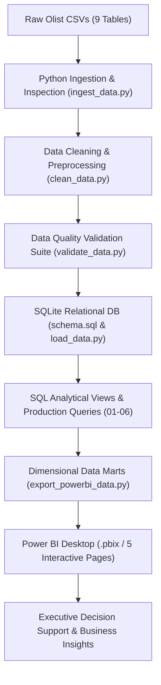
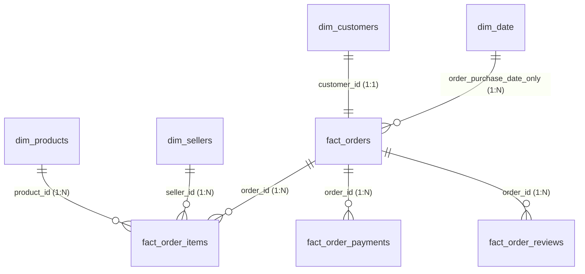

# Olist E-Commerce Sales & Business Intelligence Analytics

[](https://www.python.org/)
[](https://www.sqlite.org/)
[](https://powerbi.microsoft.com/)
[](tests/)
[](https://creativecommons.org/licenses/by-nc-sa/4.0/)

An end-to-end analytics engineering and business intelligence platform analyzing customer acquisition, customer retention (RFM), product category Pareto concentration, delivery logistics friction, payment financing channels, and executive sales performance for Brazilian e-commerce marketplace **Olist**.

---

## 1. Executive Summary & Business Objectives

Modern multi-sided e-commerce platforms operate across distributed networks of merchants, customers, regional freight carriers, and payment gateways. Commercial leadership requires a reliable, validated analytical data platform to resolve core operational and commercial questions:

1. **Executive Performance**: What is our total revenue, order volume, freight volume, and average order value across quarterly cycles?
2. **Product Strategy & Pareto (80/20) Dynamics**: Which product categories generate 80% of platform revenue, and which underperform with low review ratings or excessive freight overhead?
3. **Customer Retention & RFM Behavior**: What is the actual platform customer repeat purchase rate, what are typical reorder intervals, and how are customers distributed across behavioral RFM cohorts?
4. **Logistics & Delivery SLA Compliance**: Where are regional delivery bottlenecks located, what is our on-time delivery rate, and how do delivery delays directly impact customer satisfaction and 1-star dissatisfaction rates?
5. **Geographic Distribution & Freight Equity**: Which states and cities drive marketplace demand, and how does regional distance from manufacturing hubs affect freight pricing and transit duration?

---

## 2. Key Verified Insights

All findings below are reconciled across the relational database, automated unit tests, analytical query marts, and Power BI semantic models:

- **Commercial Scale**: Across **99,441 unique marketplace orders** and **112,650 order items**, the marketplace recorded **R\$ 13,591,643.70** in item merchandise revenue, **R\$ 2,251,909.54** in freight charges, and a gross freight-inclusive order value of **R\$ 15,843,553.24**.
- **Customer Retention Profile**: Analysis of **96,096 distinct real-world buyers** (`customer_unique_id`) reveals a high-churn marketplace model: **93,099 customers (96.88%)** made only 1 purchase, while **2,997 customers (3.12%)** were repeat buyers. This 3.12% repeat customer cohort accounted for **6,342 orders** and **R\$ 684,008.31** in merchandise spend.
- **Pareto Revenue Concentration**: Across **74 catalog categories**, revenue follows a strict Pareto distribution: **17 Core categories (23.0%)** generate **79.62% (R\$ 10,822,328.51)** of all merchandise sales. The top 3 categories are `health_beauty` (R\$ 1.26M), `watches_gifts` (R\$ 1.21M), and `bed_bath_table` (R\$ 1.04M).
- **Logistics & Delivery Satisfaction**: Across the strict cohort of **96,470 timestamped delivered orders**, **88,644 orders (91.89%)** arrived on or before the estimated carrier SLA, maintaining an average customer review rating of **4.29 / 5.00** and a low 1-star dissatisfaction rate of **6.56%**. Conversely, orders delayed >7 days past the carrier SLA suffered an average review score of **1.73 / 5.00** with **68.61% 1-star reviews**.
- **Geographic Concentration**: The State of São Paulo (`SP`) represents the single largest commercial hub, generating **41,746 orders (41.98% volume share)**, **40,302 buyers (41.94% reach share)**, and **R\$ 5,202,955.05 in merchandise revenue (38.28% item share)** with an average transit time of 8.76 days and average freight cost of R\$ 17.37 per item.
- **Payment Tender & Financing**: Customers transacted **R\$ 16,008,872.12** across **103,886 payment records**. Credit cards dominate the marketplace, capturing **78.34% of total value (R\$ 12.54M)** across 76,795 transactions, with **66.85%** utilizing multi-month installment financing (averaging 3.51 installments, up to a 24-month maximum).

---

## 3. Technology Stack & Design Decisions

| Technology | Purpose | Implementation Highlights |
|---|---|---|
| **Python 3.13.2** | Automated ETL & Data Quality Validation | Cleaned raw data, resolved missing values, parsed ISO-8601 timestamps, engineered postal centroid coordinates, and validated domain boundaries. |
| **Pandas & NumPy** | High-Performance Data Transformation | Vectorized datetime difference computations, median coordinate aggregation, and decimal financial reconciliation. |
| **SQLite3** | Normalized Relational Database Engine | Embedded serverless database implementing full ANSI SQL, strict foreign key constraints (`PRAGMA foreign_keys = ON`), conformed dimensions, indexes, and reporting views. |
| **Power BI Desktop** | Semantic Modeling & Executive Dashboards | Star-constellation enterprise model (8 tables, 14 single-direction relationships, zero bidirectional leaks) and 31 custom DAX measures across 5 interactive report pages. |
| **Matplotlib & Seaborn** | Exploratory Data Analysis (EDA) | Statistical visualization scripts analyzing distributions, Pareto cumulative curves, delivery lag scatter plots, and correlation matrices. |
| **Unittest Framework** | Automated Integrity & Regression Testing | 17 automated tests asserting 100% referential integrity, primary key uniqueness, row count parity, and decimal financial reconciliation. |
| **Git & GitHub** | Version Control & Portfolio Governance | Granular, conventional commit history tracking every verified engineering milestone. |

---

## 4. Architecture & Data Flow



For granular schema details, entity grains, and relationship definitions, see [Architecture Documentation](docs/architecture.md) and [Data Dictionary](docs/data_dictionary.md).

---

## 5. Repository Structure

```text
Olist-Ecommerce-Analytics/
├── .gitignore                          # Excludes raw data, SQLite binaries, temp files, caches
├── README.md                           # Main portfolio guide and technical documentation
├── requirements.txt                    # Pinned, tested Python 3.13.2 dependencies
├── data/
│   ├── raw/                            # Original raw Olist CSV tables (user downloaded)
│   └── processed/                      # Cleaned CSV files after Python ETL
│       └── powerbi/                    # Star-schema analytical tables & benchmark query marts
├── database/
│   ├── schema.sql                      # DDL schema with primary/foreign keys & check constraints
│   ├── create_database.py              # SQLite database initializer runner
│   ├── load_data.py                    # Automated loader populating database/ecommerce.db
│   ├── views.sql                       # 4 analytical reporting views
│   ├── run_queries.py                  # Analytical query runner & view manager
│   ├── export_powerbi_data.py          # Data mart extraction script for Power BI
│   └── queries/                        # 6 Production SQL analytical scripts
│       ├── 01_monthly_sales_trends.sql
│       ├── 02_product_category_performance.sql
│       ├── 03_customer_rfm_behavior.sql
│       ├── 04_regional_geography_analysis.sql
│       ├── 05_payment_channel_breakdown.sql
│       └── 06_delivery_efficiency_and_reviews.sql
├── docs/
│   ├── architecture.md                 # System architecture & grain specifications
│   ├── data_dictionary.md              # Column-level definitions & schema dictionaries
│   ├── powerbi_data_model.md           # Star-constellation schema documentation
│   ├── powerbi_dashboard_guide.md      # Step-by-step visual creation & DAX catalog
│   └── images/
│       ├── eda/                        # 8 verified statistical visualizations
│       └── dashboard/                  # Dashboard screenshot assets
├── notebooks/
│   └── exploratory_analysis.ipynb      # Executed EDA notebook with 8 statistical figures
├── powerbi/
│   └── Olist_Ecommerce_Analytics.pbix  # 5-Page Power BI interactive report file
├── preprocessing/
│   ├── ingest_data.py                  # Raw CSV inspection & dimension verification
│   ├── clean_data.py                   # Data cleaning, null imputation & feature engineering
│   └── validate_data.py                # 6 automated validation rules & report generator
├── reports/
│   ├── data_quality_report.md          # ETL data quality and cleansing audit
│   ├── database_validation_report.md   # SQLite schema and relational verification audit
│   ├── sql_analysis_report.md          # Detailed analytical query findings & business insights
│   └── powerbi_dataset_validation_report.md # Export parity and financial reconciliation audit
└── tests/
    ├── test_sql_integrity.py          # Relational constraint & SQLite view test suite (8 tests)
    └── test_powerbi_exports.py        # Export parity & financial reconciliation test suite (9 tests)
```

---

## 6. Relational Database Design

The relational database (`database/ecommerce.db`) is structured as a **Star-Constellation Schema** comprising conformed dimensions and granular fact tables:



### Table Dimensions & Facts

| Table Name | Entity Type | Primary Key | Record Count | Description & Grain |
|---|---|---|:---:|---|
| `dim_date` | Conformed Dimension | `date` | 1,827 | Continuous calendar from 2016-01-01 to 2020-12-31. |
| `dim_customers` | Conformed Dimension | `customer_id` | 99,441 | One row per transaction customer ID, enriched with `customer_unique_id`, postal coordinates, and RFM attributes. |
| `dim_products` | Conformed Dimension | `product_id` | 32,951 | One row per catalog SKU, enriched with English category translations and Pareto classes (A/B/C). |
| `dim_sellers` | Conformed Dimension | `seller_id` | 3,095 | One row per registered seller with postal code, city, and state. |
| `dim_geolocation` | Reference Lookup | `geolocation_zip_code_prefix` | 19,010 | Deduplicated median postal coordinates filtered for Brazilian spatial boundaries. |
| `fact_orders` | Header Fact | `order_id` | 99,441 | Order lifecycle headers, statuses, purchase/delivery timestamps, and delivery delay metrics. |
| `fact_order_items` | Line Item Fact | Composite (`order_id`, `order_item_id`) | 112,650 | Granular item prices, freight values, and seller/product keys. |
| `fact_order_payments` | Child Fact | Composite (`order_id`, `payment_sequential`) | 103,886 | Tender types, installment plans, and recorded transaction amounts. |
| `fact_order_reviews` | Child Fact | `review_id` | 99,224 | Customer review scores (1 to 5), survey creation dates, and review response timestamps. |

### Architectural Guardrails
1. **Strict 1:1 Customer Cardinality**: Each record in `dim_customers` maps to exactly one record in `fact_orders` on `customer_id`. Real-world repeat purchasing is analyzed by grouping by `customer_unique_id`.
2. **Single-Direction Filter Propagation**: All relationships filter unidirectionally from dimension to fact (`1 -> *`), completely eliminating bidirectional cross-filtering ambiguities and cyclical query paths.
3. **Dedicated Inactive Date Lifecycles**: The date dimension connects to `fact_orders` via 1 active relationship (`order_purchase_date_only`) and 7 inactive relationships (`approved_date`, `delivered_carrier_date`, `delivered_customer_date`, `estimated_delivery_date`, `review_creation_date`, `review_answer_date`, `shipping_limit_date`) activated dynamically via DAX `USERELATIONSHIP`.

---

## 7. SQL Analysis & Analytical Reporting Views

Four production views and six analytical SQL scripts extract high-impact business insights:

- **01 Monthly Sales Trends** (`01_monthly_sales_trends.sql`): Evaluates 25-month sales progression, customer volume, MoM revenue growth rates, and cumulative marketplace gross revenue.
- **02 Product Category Pareto Analysis** (`02_product_category_performance.sql`): Computes 80/20 cumulative revenue share across 74 categories, classifying SKUs into Core 80% (A), Mid 15% (B), and Tail 5% (C).
- **03 Customer RFM Segmentation** (`03_customer_rfm_behavior.sql`): Computes Recency, Frequency, and Monetary scores across 96,096 distinct buyers, segmenting customers into 8 standard behavioral cohorts (Champions, Loyal Customers, At Risk, Hibernating, etc.).
- **04 Regional Geography & Freight Economics** (`04_regional_geography_analysis.sql`): Aggregates sales volume, freight burden, delivery duration, and postal match rates across all 27 Brazilian states.
- **05 Payment Channel & Financing Breakdown** (`05_payment_channel_breakdown.sql`): Analyzes payment tender split, installment distributions, and average transaction size by tender type.
- **06 Delivery Timeliness & Review Sentiment** (`06_delivery_efficiency_and_reviews.sql`): Evaluates SLA compliance across delivery delay buckets and quantifies customer review score decay and 1-star dissatisfaction spikes.

---

## 8. Exploratory Data Analysis (EDA)

The Jupyter notebook ([notebooks/exploratory_analysis.ipynb](file:///notebooks/exploratory_analysis.ipynb)) contains 8 detailed statistical visualizations:

| Figure | Analysis Theme | Key Finding Visualized |
|:---:|---|---|
| **01** | **Monthly Sales & MoM Growth** | Identifies the November 2017 Black Friday peak (R\$ 1.18M gross value) and structural seasonal scaling. |
| **02** | **Category Pareto (80/20) Curve** | Visualizes cumulative revenue curve proving 17 of 74 categories generate 79.62% of sales. |
| **03** | **Customer RFM Cohort Distribution** | Visualizes the distribution of 96,096 buyers, highlighting the 96.88% single-order baseline. |
| **04** | **Regional Freight & Delivery Disparity** | Compares Southeast transit efficiency (SP: 8.8 days) against Northern states (RR: 29.0 days). |
| **05** | **Delivery Duration Distribution** | Right-skewed distribution of 96,470 shipments with a median delivery time of 10.2 days. |
| **06** | **Delivery Timeliness Rates** | Demonstrates the 91.89% on-time fulfillment rate against carrier delivery estimates. |
| **07** | **Delay vs. Review Score Correlation** | Illustrates the collapse in customer review scores as delivery delays exceed 3 days. |
| **08** | **Payment Method & Installment Adoption** | Compares tender market share and demonstrates credit card installment adoption (66.85%). |

All 8 figures are preserved in high-resolution PNG format under [docs/images/eda/](docs/images/eda/).

---

## 9. Power BI Interactive Dashboard

The Power BI dashboard ([powerbi/Olist_Ecommerce_Analytics.pbix](file:///powerbi/Olist_Ecommerce_Analytics.pbix)) is organized across 5 dedicated analytical pages:

1. **Executive Overview**: Executive KPI cards, 25-month historical sales combo chart, payment tender donut chart, and dynamic date/state slicers.
2. **Product Performance**: Top product category rankings, 80/20 Pareto cumulative revenue chart, average order size, and product category matrix table.
3. **Customer Analytics & RFM**: Distinct real-world buyer counts (96,096), repeat buyer rate (3.12%), single-order vs repeat buyer donut chart, and RFM behavioral cohort matrix.
4. **Regional Geography & Logistics**: Geographic bubble map of Brazilian customer centroids, state-level revenue rankings, freight cost bar charts, and transit duration comparisons.
5. **Delivery Performance & Satisfaction**: Dedicated strict SLA cohort analysis (96,470 orders), delivery performance buckets (`0. Early / On-Time` to `3. Severely Late`), review score distributions, and dual-axis satisfaction decay curve.

For complete visual layouts, field bindings, and the full 31-measure DAX catalog, refer to [docs/powerbi_dashboard_guide.md](docs/powerbi_dashboard_guide.md).

---

## 10. Data Integrity & Financial Limitations

To ensure sound analytical integrity, the following data realities and limitations are documented:

1. **Item Revenue vs. Order Value vs. Payment Total Reconciliation**:
   - Total Item Merchandise Revenue = **R\$ 13,591,643.70**
   - Total Freight Charges = **R\$ 2,251,909.54**
   - Total Freight-Inclusive Order Value = **R\$ 15,843,553.24**
   - Total Recorded Payment Value = **R\$ 16,008,872.12**
   - Payment Value Variance = **+R\$ 165,318.88 (+1.04%)**
   - *Explanation*: The R\$ 165.3K residual variance reflects multi-tender order processing, credit card installment financing fee structures, payment gateway rounding, and post-order adjustments recorded in payment logs.
2. **Absence of Cost of Goods Sold (COGS)**:
   - The Olist dataset records transactional merchant prices and shipping fees but does not record wholesale merchant procurement costs (COGS), seller marketing expenses (CAC), or operating platform overhead. Therefore, all financial metrics report **gross merchandise revenue** and **gross order value**, not net profit or profit margins.
3. **Delivery Timestamp Anomalies**:
   - Exactly **6 orders** contain `order_status = "canceled"` yet record an `order_delivered_customer_date`. The dataset does not establish the root cause for these combined states. They are strictly excluded from delivered-order SLA metrics.
   - Exactly **8 orders** contain `order_status = "delivered"` without a recorded delivery timestamp. These are accounted for in total delivered status volume (96,478) but excluded from delivery duration calculations (96,470).
4. **Observational Correlation vs. Causality**:
   - Delivery delay correlates strongly with negative reviews, but review text analysis indicates that customer sentiment also reflects product defect rates, packaging damage, and seller miscommunication.

---

## 11. Reproducibility & Installation Guide

### Prerequisites
- **Python**: Version 3.10+ (Tested on Python 3.13.2)
- **Git**: Installed and configured
- **Power BI Desktop**: Required to open `.pbix` report files (Windows)

### Step 1: Clone the Repository
```bash
git clone https://github.com/nandinipatel8011/Olist-Ecommerce-Analytics.git
cd Olist-Ecommerce-Analytics
```

### Step 2: Install Python Dependencies
```bash
pip install -r requirements.txt
```

### Step 3: Download & Place the Raw Olist Dataset
1. Download the Brazilian E-Commerce dataset from Kaggle:  
   [https://www.kaggle.com/datasets/olistbr/brazilian-ecommerce](https://www.kaggle.com/datasets/olistbr/brazilian-ecommerce)
2. Extract the 9 raw CSV files directly into `data/raw/`:
   - `olist_orders_dataset.csv`
   - `olist_order_items_dataset.csv`
   - `olist_order_payments_dataset.csv`
   - `olist_order_reviews_dataset.csv`
   - `olist_customers_dataset.csv`
   - `olist_products_dataset.csv`
   - `olist_sellers_dataset.csv`
   - `olist_geolocation_dataset.csv`
   - `product_category_name_translation.csv`

### Step 4: Run the Complete Data Pipeline
```bash
# 1. Ingest and verify raw data presence
python preprocessing/ingest_data.py

# 2. Clean data and engineer features
python preprocessing/clean_data.py

# 3. Validate data quality rules and domain integrity
python preprocessing/validate_data.py

# 4. Initialize SQLite schema and create tables
python database/create_database.py

# 5. Load cleaned data into SQLite relational tables
python database/load_data.py

# 6. Apply analytical reporting views and execute analytical queries
python database/run_queries.py

# 7. Export conformed data marts for Power BI
python database/export_powerbi_data.py
```

### Step 5: Run Automated Test Suite
```bash
python -m unittest discover tests -v
```
*Expected Result*: `Ran 17 tests in ~24s ... OK`

### Step 6: Launch Power BI Dashboard
Open `powerbi/Olist_Ecommerce_Analytics.pbix` directly in **Power BI Desktop**. All datasets and DAX measures are embedded and pre-configured.

---

## 12. Future Improvements

- **Automated Scheduled Refresh**: Integrate with Azure Data Factory or GitHub Actions to execute the Python/SQLite ETL pipeline on scheduled intervals.
- **Customer Lifetime Value (LTV) Prediction**: Build a machine learning regression model (e.g. BG/NBD, Gamma-Gamma) to forecast future purchase probability and customer lifetime spend.
- **Natural Language Processing (NLP) on Reviews**: Perform sentiment analysis and topic modeling on customer Portuguese review comments to categorize causes of dissatisfaction (packaging vs transit delay vs defective product).
- **Cloud BI Deployment**: Publish semantic models to Power BI Service / Microsoft Fabric with row-level security (RLS) for regional sales managers.

---

## 13. License & Attribution

- **Dataset Source**: [Brazilian E-Commerce Public Dataset by Olist](https://www.kaggle.com/datasets/olistbr/brazilian-ecommerce) published by Olist and André Sionek on Kaggle.
- **Dataset License**: [Creative Commons Attribution-NonCommercial-ShareAlike 4.0 International (CC BY-NC-SA 4.0)](https://creativecommons.org/licenses/by-nc-sa/4.0/).
- **Project Author**: **Nandini Patel** ([GitHub: @nandinipatel8011](https://github.com/nandinipatel8011))
