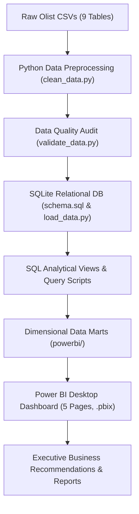

# E-Commerce Sales & Business Intelligence Analytics Platform

[](https://www.python.org/)
[](https://www.sqlite.org/)
[](https://powerbi.microsoft.com/)
[](https://creativecommons.org/licenses/by-nc-sa/4.0/)

An end-to-end, industry-grade analytics engineering platform analyzing sales performance, customer retention, product portfolios, regional geography, and delivery logistics for an e-commerce marketplace using real transaction data.

---

## 1. Business Problem & Executive Objectives

Modern e-commerce platforms handle millions of transactional events across distributed merchants, customers, and delivery partners. Leadership requires a reliable, validated analytical system to answer critical business questions:

1. **Executive Performance**: What is our total revenue, order volume, and average order value (AOV) across seasons?
2. **Product Strategy**: Which product categories drive 80% of revenue, and which underperform with low review ratings?
3. **Customer Retention**: What is the actual customer repeat purchase rate, and what are the purchase intervals?
4. **Logistics & Delivery**: Where are delivery bottlenecks located, and how do delivery delays affect customer review scores?
5. **Geographic Distribution**: Which states and cities dominate demand, and how does regional freight cost impact delivery times?

---

## 2. Technology Stack & Design Decisions

| Technology | Purpose | Why Selected |
|---|---|---|
| **Python 3.13.2** | Data Preprocessing, Cleaning & Validation | Industry-standard language for ETL pipelines, programmatic validation, and statistical auditing. |
| **Pandas & NumPy** | Data Manipulation & Vectorized Computation | Robust handling of missing values, timestamp parsing, deduplication, and feature engineering. |
| **SQLite3** | Relational Database Engine | Zero-configuration, serverless, file-based SQL database built into Python. Supports standard SQL, CTEs, Window Functions, and Views without heavyweight server management. |
| **Power BI Desktop** | Business Intelligence & Dashboard Interface | Enterprise BI standard for interactive reporting, Star-Schema dimensional modeling, and DAX calculations. |
| **Matplotlib & Seaborn** | Exploratory Data Analysis (EDA) | Statistical visualization library for distributional and correlation analysis. |
| **Git & GitHub** | Version Control & Collaboration | Discipline-driven, granular commit history tracking every verified engineering milestone. |

---

## 3. Architecture & Data Flow



For full details on table grains, fan-out mitigation rules, and spatial coordinate trade-offs, see [Architecture Documentation](docs/architecture.md) and [Data Dictionary](docs/data_dictionary.md).

---

## 4. Repository Structure

```text
Project1_EcommerceAnalytics/
├── .gitignore                          # Ignores large raw files, SQLite binaries, temp files
├── README.md                           # Main project presentation & guide
├── requirements.txt                    # Pinned, tested Python 3.13.2 dependencies
├── data/
│   ├── raw/                            # Original 9 Olist CSV tables
│   ├── processed/                      # Cleaned CSV files after Python ETL
│   │   └── powerbi/                    # Star-schema analytical tables for Power BI
├── notebooks/
│   └── exploratory_analysis.ipynb      # EDA notebook with statistical charts
├── preprocessing/
│   ├── __init__.py
│   ├── clean_data.py                   # Data cleaning and feature engineering
│   └── validate_data.py                # Data quality audit and reconciliation rules
├── database/
│   ├── schema.sql                      # DDL with primary, foreign keys, and constraints
│   ├── create_database.py              # SQLite database creation runner
│   ├── load_data.py                    # Automated loader populating ecommerce.db
│   └── queries/                        # 6 Production SQL analytical scripts
├── powerbi/
│   ├── dax_measures.md                 # Complete DAX catalog with explanations
│   ├── data_model.md                   # Star-schema relationships and cardinality
│   ├── powerbi_guide.md                # Step-by-step visual creation guide
│   └── ecommerce_analytics.pbix        # Verified Power BI Dashboard file
├── reports/
│   ├── data_quality_report.md          # Data cleaning audit, missing value treatment
│   └── business_insights.md            # Actionable management recommendations
├── tests/
│   ├── __init__.py
│   ├── test_cleaning.py                # Unit tests for preprocessing functions
│   ├── test_sql_integrity.py          # Relational constraint & view tests
│   └── reconcile_metrics.py            # Python vs SQLite KPI reconciliation
└── docs/
    ├── architecture.md                 # System architecture & grain specifications
    ├── data_dictionary.md              # Column-level definitions & customer ID logic
    └── interview_guide.md              # Concepts, trade-offs, and interview Q&A
```

---

## 5. Dataset Source & Attribution

- **Dataset**: Brazilian E-Commerce Public Dataset by Olist
- **Source**: Kaggle ([https://www.kaggle.com/datasets/olistbr/brazilian-ecommerce](https://www.kaggle.com/datasets/olistbr/brazilian-ecommerce))
- **Author**: Olist and André Sionek
- **License**: CC BY-NC-SA 4.0

---

## 6. Installation & Environment Setup

### Prerequisites
- Python 3.13.2 installed.
- Git installed.
- Power BI Desktop installed (Windows).

### 1. Clone the repository
```bash
git clone https://github.com/nandinipatel8011/ecommerce-sales-bi.git
cd ecommerce-sales-bi
```

### 2. Install dependencies
```bash
pip install -r requirements.txt
```

---

## 7. Implementation Roadmap & Status

- [x] **Phase 1: Project Structure, Architecture & Foundational Documentation**
- [ ] **Phase 2: Raw Data Ingestion & Schema Verification**
- [ ] **Phase 3: Python Data Preprocessing & Data Quality Audit**
- [ ] **Phase 4: SQLite Relational Database & Constraints**
- [ ] **Phase 5: SQL Analytical Queries & Production Views**
- [ ] **Phase 6: Exploratory Data Analysis & Statistical Storytelling**
- [ ] **Phase 7: Power BI Dimensional Mart Preparation**
- [ ] **Phase 8: Power BI Dashboard & DAX Measures (.pbix)**
- [ ] **Phase 9: Strategic Business Insights & Management Recommendations**
- [ ] **Phase 10: Automated Testing & Python-SQL Reconciliation**
- [ ] **Phase 11: Comprehensive Interview Preparation Guide**
- [ ] **Phase 12: GitHub Publishing**

---

## Author
- **Nandini Patel** ([GitHub: nandinipatel8011](https://github.com/nandinipatel8011))
- B.Tech Computer Science | Aspiring Data Analyst & BI Developer
