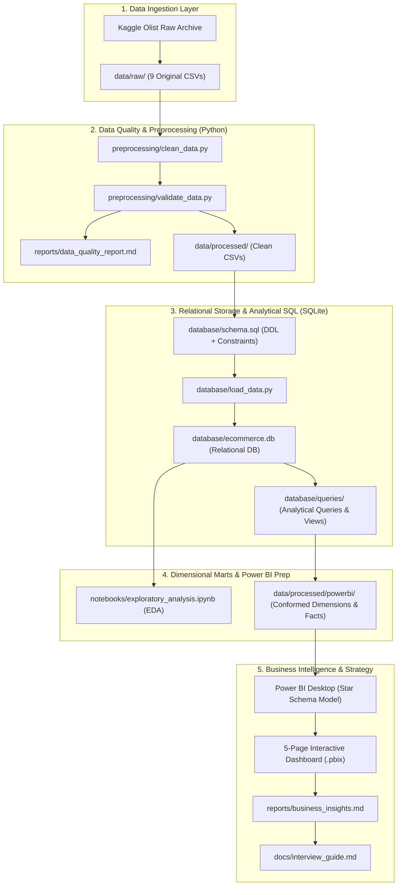

# E-Commerce Analytics Platform Architecture

## 1. System Overview

This platform implements an end-to-end analytics engineering pipeline transforming raw Brazilian e-commerce transaction data (Olist) into relational models, analytical views, statistical exploratory analyses, and an executive-ready Power BI dashboard.



---

## 2. Table Grains & Entity Relationships

Understanding the exact **grain** (what one row represents) of each table is critical in e-commerce analytics to prevent duplicate counting during aggregations.

| Table Name | Entity Type | Grain Definition | Primary Key | Foreign Keys | Key Measures / Attributes |
|---|---|---|---|---|---|
| `fact_orders` | Fact (Snapshot) | One row per customer order | `order_id` | `customer_id` | `order_status`, order milestones (`purchase`, `approved`, `delivered`, `estimated`) |
| `fact_order_items` | Fact (Transaction) | One row per item within an order | `order_id, order_item_id` | `order_id`, `product_id`, `seller_id` | `price`, `freight_value` |
| `fact_order_payments` | Fact (Financial) | One row per payment transaction attempt | `order_id, payment_sequential` | `order_id` | `payment_type`, `payment_installments`, `payment_value` |
| `fact_order_reviews` | Fact (Feedback) | One row per review survey submission | `review_id, order_id` | `order_id` | `review_score`, `review_creation_date` |
| `dim_customers` | Dimension | One row per order-customer identity | `customer_id` | None | `customer_unique_id`, `customer_zip_code_prefix`, `customer_city`, `customer_state` |
| `dim_products` | Dimension | One row per catalog product | `product_id` | None | `product_category_name_english`, dimensions, weight |
| `dim_sellers` | Dimension | One row per marketplace seller | `seller_id` | None | `seller_zip_code_prefix`, `seller_city`, `seller_state` |
| `dim_date` | Conformed Dim | One row per calendar date | `date_key` | None | `year`, `quarter`, `month`, `month_name`, `day`, `day_of_week` |
| `dim_geolocation` | Dimension (Aggregated) | One row per 5-digit postal prefix | `geolocation_zip_code_prefix` | None | `median_latitude`, `median_longitude`, `city`, `state` |

---

## 3. Fan-Out & Cartesian Multiplication Prevention

### The Problem
In an e-commerce data model, relationships between orders, items, payments, and reviews are one-to-many:
- 1 Order $\rightarrow$ $N$ Order Items (a buyer purchases 3 different items).
- 1 Order $\rightarrow$ $M$ Payments (a buyer splits payment between 2 credit cards or a voucher and a card).
- 1 Order $\rightarrow$ $K$ Reviews (a customer updates or posts multiple survey responses).

If a query joins `fact_orders` with `fact_order_items` and `fact_order_payments` directly in a single `JOIN` block:
$$\text{Output Rows} = 1 \times N \times M$$
For an order with 2 items and 2 payments, 4 rows will be generated. Calculating `SUM(payment_value)` on this combined table will duplicate the payment amounts by a factor of 2. Calculating `SUM(price)` will duplicate the product prices by a factor of 2.

### Architecture Rules
1. **SQL CTE Pre-Aggregation**: Multi-table queries must pre-aggregate metrics to the `order_id` grain inside separate Common Table Expressions (CTEs) before joining:
   ```sql
   WITH order_item_totals AS (
       SELECT order_id, SUM(price) AS total_item_value, SUM(freight_value) AS total_freight
       FROM order_items
       GROUP BY order_id
   ),
   order_payment_totals AS (
       SELECT order_id, SUM(payment_value) AS total_payment_value
       FROM order_payments
       GROUP BY order_id
   )
   SELECT o.order_id, i.total_item_value, i.total_freight, p.total_payment_value
   FROM orders o
   LEFT JOIN order_item_totals i ON o.order_id = i.order_id
   LEFT JOIN order_payment_totals p ON o.order_id = p.order_id;
   ```
2. **Power BI Constellation Schema**: In Power BI, fact tables are never directly linked to each other. Instead, each fact table (`fact_order_items`, `fact_order_payments`, `fact_orders`) connects via 1-to-many single-direction relationships to shared conformed dimensions (`dim_date`, `dim_customers`, `dim_products`, `dim_sellers`). This allows the DAX VertiPaq engine to compute aggregations independently without Cartesian expansion.

---

## 4. Geolocation Optimization & Documented Spatial Trade-off

The raw dataset `olist_geolocation_dataset.csv` contains **1,000,163 rows** recording GPS coordinates for postal codes across Brazil. Many rows share the exact same 5-digit zip code prefix with microscopic variations in latitude and longitude representing different street corners.

### Design Decision
- **Raw File Preserved**: The full 1M+ row raw CSV is retained untouched in `data/raw/olist_geolocation_dataset.csv` for auditability and spatial reproduction.
- **Aggregated Dimension for Production Analytics**: We compute `dim_geolocation` by grouping on `geolocation_zip_code_prefix`:
  - `median_latitude` = `MEDIAN(geolocation_lat)`
  - `median_longitude` = `MEDIAN(geolocation_lng)`
  - `city` = Mode (most frequent city name for that zip code)
  - `state` = Mode (state abbreviation)
- **Documented Spatial Trade-off**:
  - *Advantage*: Reduces record count from 1,000,163 to ~19,000 records (~98% reduction), dramatically improving SQLite join performance, memory utilization, and Power BI report responsiveness.
  - *Limitation / Loss of Detail*: Aggregating to the median coordinate centroid removes micro-level street variance. For high-level regional, state, and municipal geospatial intelligence, this accuracy loss is negligible, but it is not intended for micro-route logistics or exact doorstep navigation.

---

## 5. Metric Reconciliation Framework

To ensure 100% data integrity across the platform:
1. **Automated Python-vs-SQL Reconciliation**:
   - `tests/reconcile_metrics.py` programmatically runs identical aggregations in Pandas and SQLite.
   - Asserts zero delta on:
     - Total Item Product Revenue ($\sum \text{price}$)
     - Total Freight Amount ($\sum \text{freight\_value}$)
     - Freight-Inclusive Order Value ($\sum (\text{price} + \text{freight\_value})$)
     - Total Recorded Payment Value ($\sum \text{payment\_value}$)
     - Total Distinct Orders ($\text{COUNT(DISTINCT order\_id)}$)
     - Total Unique Customers ($\text{COUNT(DISTINCT customer\_unique\_id)}$)
2. **Power BI Manual Audit Checklist**:
   - The test script generates an audit table containing the exact expected numbers.
   - The user cross-verifies these figures against the Power BI KPI card visuals in `powerbi/ecommerce_analytics.pbix`.
